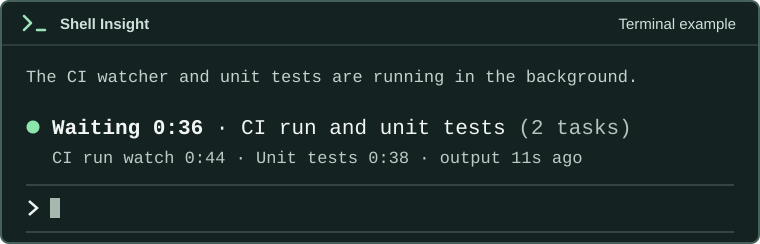
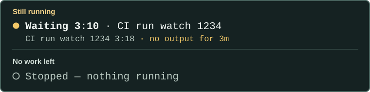

# Shell Insight

When Claude Code hands you back the prompt, a background shell may still be running. Shell Insight adds a row just above the prompt showing **what is still running, for how long, and when it last produced output**. While Claude is working, the row stays hidden.



[Install](#install) · [Try it](#try-it) · [Read the row](#what-the-row-means) · [Options](#options)

## Install

You need Claude Code with native mod support (tested on **2.1.330**). No clone or npm install is needed. At the **Claude Code prompt**, enter:

```text
/plugin install shell-insight --marketplace tsunheimat/claude-code-shelllens
```

Confirm the marketplace and choose your scope (**user** makes it available across your projects). Run `/reload-plugins` or restart Claude Code.

Prefer a **shell command**? This installs the same plugin for your user:

```sh
claude plugin install shell-insight --marketplace tsunheimat/claude-code-shelllens --scope user
```

**Privacy:** script inspection happens locally. Model-written summaries send selected output and agent-written text to your configured model endpoint, which can be a custom gateway. That text can contain private information or echo code, and credential masking is best-effort. Disable the plugin in sessions where this data must not reach the endpoint. Local fallback labels do not require a model response.

## Try it

Give Claude this prompt in any project:

```text
Run sleep 30 as a background Bash task, then end your turn without waiting for it.
```

Once Claude returns the prompt, look just above it for `● Waiting`. After the timer finishes and Claude Code reports completion, the row reads `○ Stopped — nothing running` if no other work remains. The task label can vary; the state is what to look for.

## What the row means

In the preview above, **`Waiting 0:36`** counts from when Claude stopped, but **`CI run watch 0:44`** counts from when that task started. **`output 11s ago`** is the newest known output across the remaining tasks.



The waiting dot is green by default. It turns yellow when the newest known output is more than two minutes old. A quiet shell is not necessarily stuck. A completion notification removes the task from the row; scheduled wakeups also count as pending work.

Labels appear immediately from task descriptions and local facts. A model request can refine them. During the same stopped turn, the plugin refreshes at most once per minute when output or the task set changes, remembers changes during cooldown, and discards stale replies.

The row reports what the host says is still running and what the output files show. It does not watch CI itself or claim a result; a task's end is shown by Claude Code's own notification.

## Inspection policy

- At background handoff the plugin parses the command without running it. It recognizes common wrappers such as `timeout`, `env`, and `rtk proxy`, and can inspect literal script invocations, `source` references, and a heredoc written then invoked by the command. It follows at most six script references and three levels of nesting. It does not execute the scripts, expand variables, or resolve globs.
- A directly called shell function contributes operations; a definition alone does not. Executed child shells and parenthesized groups have their own working directory. Sourced scripts share their caller's directory. This is a bounded static analysis, not a full shell interpreter: uncertain branches or unsupported syntax can yield partial evidence.
- Disk reads are limited to eligible scripts under the launch directory or an explicitly named `.sh`/`.bash` file directly in `/tmp`. A parsed `cd` does not widen that boundary. Hidden paths, traversal, symlinks, special files, oversized scripts and non-text files are skipped. Script placement and metadata are checked before and after reading. This is not an isolation boundary against another process replacing files.
- A matched ignore rule withholds the whole task's script facts and output, even when masking is off. With rules configured, inspection starts only for an identifiable literal entry script. This rule does not remove mentions in the agent's own descriptions, last message, or scheduled reminders.

## What the summary model receives

One JSON record describes the pending work. Each task has a short ID, its description (up to 300 characters), inspection status, elapsed time when known, and up to 12 extracted operations. For example, a CI watcher can yield `{"run":"gh run watch","category":"CI run watch","target":"1234","waits":true}`. The record can include a script basename, a polling interval or timeout, and a count of omitted operations. These are clues about the work, not a trace of the currently executing line.

A simple file-test loop distinguishes what is awaited from how often it is checked: `while [ ! -f /tmp/build.ready ]; do sleep 5; done` produces `build.ready to appear (every 5s)` even without a model answer. The plugin does not check whether the file currently exists. Recognized GitHub, curl, Docker, and Kubernetes commands retain relevant targets such as the repository, endpoint, image tag, or resource and namespace.

For eligible tasks, the plugin samples the last 4 KiB of the host-reported output file and selects up to eight meaningful lines of at most 160 characters each. The request also includes the end of the last assistant message (about 700 characters), and schedules and short prompts for pending wakeups. The model is asked for one headline and one label per ID. A failed refresh preserves previously accepted wording for unchanged tasks. If membership changes, surviving task labels stay, but the old combined headline does not. Fields without accepted wording use a local fallback.

## Options

Open `/plugin configure shell-insight@shell-insight-local` in Claude Code to change these settings.

| Option | Default | Behavior |
| --- | --- | --- |
| `enabled` | `true` | Set `false` to turn the row and model calls off. |
| `model` | `haiku` | Host-approved alias or model ID, requested with low effort. The host or gateway resolves the alias. Rejection or timeout leaves the fallback. |
| `language` | `en` | Language tag for the summary; the fixed words are English. |
| `maxScriptBytes` | `65536` | Larger scripts are skipped; hard maximum 262144 bytes. |
| `summaryTimeoutMs` | `10000` | Model deadline, clamped to 100-60000 ms. |
| `redactSecrets` | `true` | Mask likely credentials in free text before selecting excerpts. Turning this off does not send script source or override ignored paths. |
| `ignorePaths` | empty | Literal file or subtree paths, one per line, absolute or relative to the launch directory. See Inspection policy. |

**Debugging:** start with `claude --plugin-dir "$PWD" --debug` and search the host debug log for `shell-insight: summary`. A line such as `tasks=3 ... facts=[read:4,read:1,read:1] model=haiku source=model headline=accepted labels=3/3` confirms that the model supplied the displayed wording. `source=fallback` means no model wording was used, `source=retained` means prior wording was kept, and `source=discarded` marks a stale request. The plugin's diagnostic does not include script bodies, output, prompts or replies. Host and provider logs have their own policies. The plugin only observes Bash; it never intercepts or reruns a command.

## Local development

From this checkout, load the working copy for one session:

```sh
claude --plugin-dir "$PWD"
```

The [manual examples](tests/manual/) include a timer and other background scripts. To remove a persistent marketplace installation, run `claude plugin uninstall shell-insight@shell-insight-local` in your shell.

## Verify

```sh
claude plugin validate . --strict
claude plugin test .
node --test tests/*.test.mjs
```

The native tests exercise the installed mod engine with mocked tools, filesystem, clock and model. The unit tests require Node 22.18+ or 24+ and no dependencies. Neither suite needs credentials or a live model. The [PRD](docs/claude-code-shell-insight-prd.md) describes the MVP and later, optional runtime monitoring.
