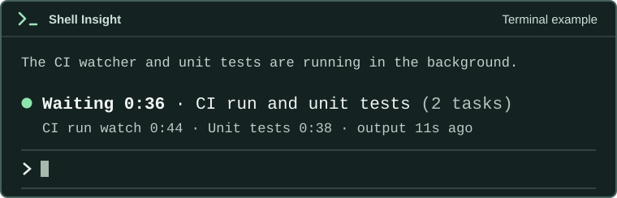
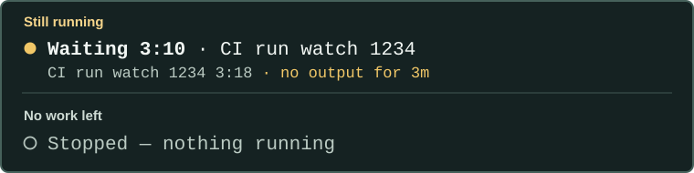

# Shell Insight

[English](README.md) · **简体中文**

Claude Code 把提示符交还给你，不代表后台任务都结束了。Shell Insight 会在提示符上方显示一行状态，告诉你**哪些任务还在运行、各自跑了多久，以及最近一次输出是什么时候**。Claude 工作时，这行状态会自动隐藏。



[安装](#安装) · [快速体验](#快速体验) · [读懂状态行](#读懂状态行) · [配置](#配置)

## 安装

需要支持原生模组（mod）的 Claude Code，已在 **2.1.330** 上验证。无需克隆仓库，也不用运行 `npm install`。在 **Claude Code 的提示符**下输入：

```text
/plugin install shell-insight --marketplace tsunheimat/claude-code-shelllens
```

确认添加插件市场后，选择安装范围。选择 **user** 即可在自己的所有项目中使用。安装后，输入 `/reload-plugins` 或重启 Claude Code 以加载插件。

也可以直接在**终端**运行以下命令，按用户范围安装同一插件：

```sh
claude plugin install shell-insight --marketplace tsunheimat/claude-code-shelllens --scope user
```

**隐私提示：**脚本在本地分析。生成模型摘要时，插件会把选取的任务输出和 Claude 写的部分文本发送到你配置的模型服务（也可能是自定义网关）。这些内容可能包含私密信息或回显的代码，凭据脱敏不能保证识别所有敏感内容。如果某个会话的数据不能发送到该服务，请在该会话中禁用插件。即使模型没有响应，插件也能显示本地生成的任务标签。

## 快速体验

在任意项目中，向 Claude 发送以下提示：

```text
请把 sleep 30 作为后台 Bash 任务运行，然后结束当前回合，不要等它执行完。
```

Claude 交还提示符后，看看它的正上方：`● Waiting` 表示还有任务在运行。30 秒后，Claude Code 收到任务完成通知；如果没有其他待办任务，状态就会变成 `○ Stopped — nothing running`。任务标签的具体措辞可能不同，观察状态变化即可。

## 读懂状态行

上图中，**`Waiting 0:36`** 表示 Claude 停止工作已有 36 秒；**`CI run watch 0:44`** 则表示 CI 监控任务从启动算起已运行 44 秒。**`output 11s ago`** 看的是所有未结束任务中最近的一次输出，不一定来自 CI 监控任务。



等待标记默认为绿色。如果已知的最近一次输出距今超过两分钟，标记会变黄。**长时间没有输出，不等于任务卡住了。** 收到完成通知后，插件会从状态行移除对应任务。已安排但尚未触发的唤醒任务也算待办事项。

插件先根据任务描述和本地分析结果显示标签，再请求模型润色。Claude 停止后的同一回合内，如果输出或任务列表变化，摘要最多每分钟刷新一次。冷却期间发生的变化会留到下一次刷新处理；过期的模型回复会被丢弃。

状态行只展示 Claude Code 报告的运行状态和输出文件中的信息。插件不会自行查询 CI，也不会把任务结束解读为构建成功；任务是否结束以 Claude Code 的通知为准。

## 脚本分析规则

- 任务转入后台时，插件只解析命令，不执行命令。它能识别 `timeout`、`env` 和 `rtk proxy` 等常见包装命令，也能分析路径直接写在命令里的脚本、`source` 引用的脚本，以及通过 heredoc 写入后又被调用的脚本。最多跟踪 6 个脚本引用，嵌套不超过 3 层；不会展开变量或通配符。
- 只有实际被调用的 shell 函数才计入操作列表，单独的函数定义不算。子 shell 和圆括号命令组有各自的工作目录；通过 `source` 加载的脚本则与调用方共享工作目录。这是有限的静态分析，不是完整的 shell 解释器；遇到无法确定的分支或不支持的语法时，结果可能不完整。
- 插件只读取启动目录下符合条件的脚本，或命令中明确指定、直接位于 `/tmp` 下的 `.sh`、`.bash` 文件。命令中的 `cd` 不会放宽读取范围。隐藏路径、路径穿越、符号链接、特殊文件、超大脚本和非文本文件都会跳过。读取前后都会检查脚本的位置和元数据，但这不能防止其他进程替换文件。
- 一旦命中忽略规则，该任务的脚本分析结果和输出都不会发送给模型，即使关闭脱敏也是如此。配置了忽略规则后，只有能从命令中直接确定入口脚本路径才会开始分析。忽略规则不会删除 Claude 在任务描述、最后一条消息或定时提醒中提到的内容。

## 摘要模型会收到什么

插件用一条 JSON 记录描述待办任务。每个任务包含短 ID、任务描述（最多 300 个字符）、分析状态、已知的运行时长，以及最多 12 个识别出的操作。例如，监控 CI 的命令可生成 `{"run":"gh run watch","category":"CI run watch","target":"1234","waits":true}`。记录还可能包含脚本文件名（不含目录）、轮询间隔、超时时间和省略的操作数。这些信息说明脚本打算做什么，并不表示脚本当前正执行哪一行。

例如，`while [ ! -f /tmp/build.ready ]; do sleep 5; done` 的目标是等待文件出现，`sleep 5` 只是检查间隔。即使模型没有回复，插件也能显示 `build.ready to appear (every 5s)`。它不会检查该文件此刻是否存在。对于能识别的 GitHub、curl、Docker 和 Kubernetes 命令，插件会保留相关目标，例如仓库、服务端点、镜像标签、资源名称和命名空间。

对于符合条件的任务，插件读取 Claude Code 指定的输出文件末尾 4 KiB，从中选取最多 8 行有意义的内容，每行不超过 160 个字符。请求还会包含 Claude 最后一条消息的末尾（约 700 个字符），以及待唤醒任务的调度信息和简短提示。模型会为整组任务生成一个标题，并为每个 ID 生成一个标签。如果刷新失败，未变化的任务会沿用上一次有效的措辞。如果任务列表有变，仍在运行的任务会保留各自的标签，但不会沿用旧的总标题。没有可用模型结果的字段会使用本地生成的文本。

## 配置

在 Claude Code 中输入 `/plugin configure shell-insight@shell-insight-local` 即可修改以下选项。想要中文摘要，可以将 `language` 设为 `zh-CN`；`Waiting` 等固定界面文字仍显示为英文。

| 选项 | 默认值 | 说明 |
| --- | --- | --- |
| `enabled` | `true` | 设为 `false` 可同时关闭状态行和模型调用。 |
| `model` | `haiku` | 使用宿主支持的模型别名或 ID，以低推理强度发起请求。别名由宿主或网关解析；请求被拒绝或超时时，使用本地标签或保留已有措辞。 |
| `language` | `en` | 模型摘要使用的语言标签，不影响固定界面文字。 |
| `maxScriptBytes` | `65536` | 跳过超过此大小的脚本；可设置的上限为 262144 字节。 |
| `summaryTimeoutMs` | `10000` | 模型请求超时时间，取值限制在 100 至 60000 毫秒。 |
| `redactSecrets` | `true` | 选取文本片段前，先遮盖疑似凭据。关闭后仍不会专门发送脚本源码，也不会绕过忽略规则。 |
| `ignorePaths` | 空 | 每行填写一个文件或目录路径，目录包括其子目录。可使用绝对路径或相对于启动目录的路径，不支持通配符。见[脚本分析规则](#脚本分析规则)。 |

**调试：**在仓库根目录运行 `claude --plugin-dir "$PWD" --debug`，然后在 Claude Code 的调试日志中搜索 `shell-insight: summary`。例如，`tasks=3 ... facts=[read:4,read:1,read:1] model=haiku source=model headline=accepted labels=3/3` 表示显示的标题和三个标签均来自模型。`source=fallback` 表示使用本地文本，`source=retained` 表示沿用之前的措辞，`source=discarded` 表示请求已过期。插件自身的诊断日志不包含脚本正文、输出、提示词或模型回复；Claude Code 和模型服务商有各自的日志策略。插件只观察 Bash 任务，不会拦截或重新执行命令。

## 本地开发

在仓库根目录运行以下命令，可以只在当前会话加载工作副本：

```sh
claude --plugin-dir "$PWD"
```

[手动测试示例](tests/manual/) 包含计时器和其他后台脚本。如需卸载此前从插件市场安装的版本，请在终端运行 `claude plugin uninstall shell-insight@shell-insight-local`。

## 验证

```sh
claude plugin validate . --strict
claude plugin test .
node --test tests/*.test.mjs
```

原生测试在已安装的模组引擎上运行，使用模拟的工具、文件系统、时钟和模型。单元测试需要 Node 22.18+ 或 24+，无需安装额外依赖。两套测试都不需要凭据，也不调用真实模型。[产品需求文档（英文）](docs/claude-code-shell-insight-prd.md) 介绍了首版功能，以及后续可选的运行时监控方案。
